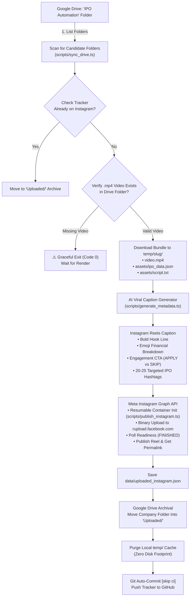

# 📸 Alpha Verdict: Instagram Reels Auto-Publisher

[](https://developers.facebook.com/docs/instagram-api/guides/content-publishing)
[](https://groq.com)
[](https://developers.google.com/drive)
[-brightgreen?logo=githubactions)](https://github.com/features/actions)

An automated cloud microservice that syncs rendered IPO vertical videos from **Google Drive**, validates video asset integrity, generates viral platform-tailored financial captions using **Groq Cloud AI (Qwen 3.8 / Llama 3.3)**, publishes directly to **Instagram Reels** via official Meta Graph API direct resumable upload, and archives processed Drive folders into a dedicated `Uploaded/` directory.

---

## 🏗️ 1. Architecture Flow



---

## 💎 2. Key Production Features

### 1. 📸 Official Meta Instagram Reels Resumable Upload
* **Zero Third-Party Storage**: Directly streams video binaries to Meta's `rupload.facebook.com` endpoint from GitHub Actions or your local machine. No AWS S3, Cloudinary, or public URL hosting required.
* **100% Ban-Safe**: Uses the official Meta Graph API with system tokens (no private/scraped Instagram APIs or fragile browser automation).
* **Automatic Polling**: Polls container transcoding readiness until `FINISHED` before triggering the public feed publish.

### 2. 🤖 AI Caption Optimization (Groq Cloud)
* Extracts core metrics from `ipo_data.json` (Issue Size, Price Band, Lot Size, Revenue, PAT).
* Generates a 3-part Instagram structure:
  1. Attention-grabbing top hook before the "more" ellipsis.
  2. Bulleted financial summary with clean emojis.
  3. Interactive call-to-action (*"Comment APPLY or SKIP"*), disclaimer, and 20–25 high-traffic hashtags.

### 3. 🗂️ Zero Clutter Google Drive Archival
* Once published, the company folder in Google Drive is automatically relocated to **`Uploaded/`** to prevent duplicate processing.

---

## ⚙️ 3. Quick Setup

### 1. Install Dependencies
```bash
npm install
```

### 2. Configure Environment (`.env`)
Copy `.env.example` to `.env`:
```env
# ─── Google Drive Ingestion ───────────────────────────────────────────────
GDRIVE_REFRESH_TOKEN=your_gdrive_refresh_token
GDRIVE_CLIENT_ID=your_client_id.apps.googleusercontent.com
GDRIVE_CLIENT_SECRET=your_client_secret
GDRIVE_PARENT_FOLDER_ID=your_parent_folder_id

# ─── Groq AI Metadata Generation ──────────────────────────────────────────
GROQ_API_KEY=gsk_your_groq_api_key
GROQ_MODEL=qwen/qwen3.8-27b

# ─── Meta Instagram Graph API ─────────────────────────────────────────────
INSTAGRAM_ACCOUNT_ID=your_instagram_business_account_id
INSTAGRAM_ACCESS_TOKEN=your_never_expiring_system_user_token
GRAPH_API_VERSION=v21.0
```

> 📖 **Instagram Credentials Setup**: Follow the complete step-by-step walkthrough in [**`INSTAGRAM_SETUP.md`**](INSTAGRAM_SETUP.md) to generate your permanent token and account ID.

### 3. Verify & Run Locally
```bash
# Verify Instagram connection & 24-hr post quota
npm run test:instagram

# Scan Google Drive for unworked folders
npm run sync:drive

# Run a complete dry-run audit (no upload)
npm run verify

# Execute live publishing pipeline
npm run publish
```

---

## 🤖 4. GitHub Actions Automation

The workflow in [`.github/workflows/instagram_publisher.yml`](.github/workflows/instagram_publisher.yml) runs **twice daily, 7 days a week**:
* **Morning Run**: `04:00 UTC` (**09:30 AM IST**)
* **Evening Run**: `14:00 UTC` (**07:30 PM IST**)
* **Manual Trigger**: Go to **Actions ➔ Scheduled Instagram Reels IPO Publisher ➔ Run workflow**.

### Required Repository Secrets
In GitHub Settings ➔ **Secrets and variables ➔ Actions**:
1. `INSTAGRAM_ACCOUNT_ID`
2. `INSTAGRAM_ACCESS_TOKEN`
3. `GDRIVE_REFRESH_TOKEN`
4. `GDRIVE_CLIENT_ID`
5. `GDRIVE_CLIENT_SECRET`
6. `GDRIVE_PARENT_FOLDER_ID`
7. `GROQ_API_KEY`
