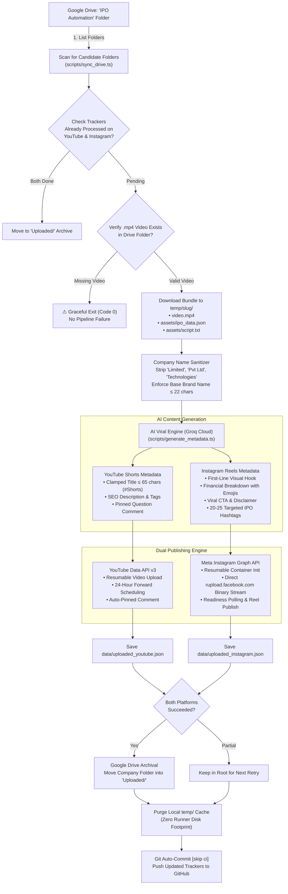
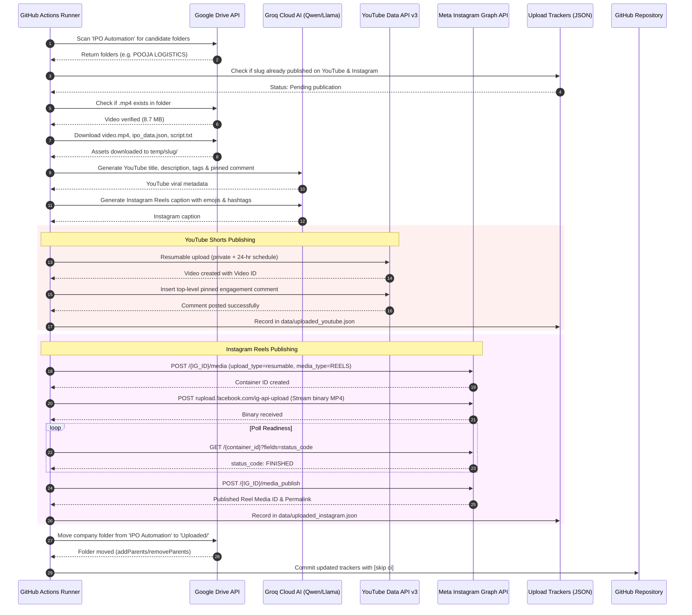

# 📺 Alpha Verdict: Multi-Platform Auto-Publisher (YouTube & Instagram)

[](https://youtube.com)
[](https://developers.google.com/youtube/v3)
[](https://developers.facebook.com/docs/instagram-api/guides/content-publishing)
[](https://groq.com)
[](https://developers.google.com/drive)
[-brightgreen?logo=githubactions)](https://github.com/features/actions)

An automated cloud microservice that syncs rendered IPO vertical videos from **Google Drive**, validates asset integrity, generates platform-tailored viral metadata using **Groq Cloud (Qwen 3.8 / Llama 3.3)**, publishes concurrently to **YouTube Shorts** (with 24-hour forward scheduling) and **Instagram Reels** (via official Meta Graph API direct resumable upload), auto-posts pinned engagement comments, and archives processed Drive folders into a dedicated `Uploaded/` directory.

---

## 🏗️ 1. System Architecture



---

## ⏱️ 2. Execution Sequence Diagram



---

## 💎 3. Key Production Features

### 1. 🛡️ Strict Title Length Clamping & Name Sanitization (YouTube)
* **Problem**: Mobile YouTube Shorts feeds truncate any title over **60–65 characters** with an ellipsis (`...`), hiding the hook and `#Shorts` tag.
* **Solution**:
  * Strips corporate legal noise words (`Private Limited`, `Pvt Ltd`, `Limited`, `Technologies`, `Industries`, `Holdings`, `India`, etc.).
  * Formula: `[Short Brand] IPO: [Hook] 🚨 #Shorts`
  * Strict code-level double-lock clamps titles $\le 65$ characters.

### 2. 📸 Official Meta Instagram Reels Resumable Upload
* **Zero Third-Party Storage**: Uses Meta's `rupload.facebook.com` binary endpoint to stream videos directly from GitHub Actions without needing AWS S3 or external hosting.
* **100% Ban-Safe**: Official Meta Graph API (no headless browsers or unofficial private APIs that get banned on datacenter IPs).
* **AI Caption Optimization**: Generates hook lines, emoji-bulleted financial breakdowns, regulatory disclaimers, engagement CTAs (*"Comment APPLY or SKIP"*), and 20–25 high-traffic hashtags.

### 3. ⏰ 24-Hour Forward Scheduling Buffer (YouTube)
* **Morning Run (~09:30 AM IST)**: Schedules for **Tomorrow Morning at 09:00 AM IST** (~23.5 hours ahead).
* **Evening Run (~07:30 PM IST)**: Schedules for **Tomorrow Evening at 06:30 PM IST** (~23.0 hours ahead).
* 100% immune to GitHub Actions runner queue latency + gives YouTube 24 hours to process high-definition VP9/AV1 codecs.

### 4. 🗂️ Independent Platform Trackers & Google Drive Archival
* Maintains separate state files:
  * `data/uploaded_youtube.json`
  * `data/uploaded_instagram.json`
* If one platform encounters a temporary API issue, the other platform's success is preserved.
* The company folder on Google Drive is moved into **`Uploaded/`** only when all active platforms succeed.

---

## ⚙️ 4. Setup Guide

### 1. Clone & Install Dependencies
```bash
git clone https://github.com/rajnishkumar13500/ipo-youtube-publisher.git
cd ipo-youtube-publisher
npm install
```

### 2. Configure Local Environment (`.env`)
Create a `.env` file based on `.env.example`:
```env
# ─── Google Drive Ingestion (Read Videos & Assets) ─────────────────────────
GDRIVE_REFRESH_TOKEN=your_gdrive_refresh_token
GDRIVE_CLIENT_ID=your_client_id.apps.googleusercontent.com
GDRIVE_CLIENT_SECRET=your_client_secret
GDRIVE_PARENT_FOLDER_ID=your_parent_folder_id

# ─── YouTube Data API v3 (Upload & Schedule Videos) ────────────────────────
YOUTUBE_CLIENT_ID=your_client_id.apps.googleusercontent.com
YOUTUBE_CLIENT_SECRET=your_client_secret
YOUTUBE_REFRESH_TOKEN=your_youtube_refresh_token
YOUTUBE_AUTO_SCHEDULE=true

# ─── Meta Instagram Graph API (Publish Instagram Reels) ────────────────────
INSTAGRAM_ACCOUNT_ID=your_instagram_business_account_id
INSTAGRAM_ACCESS_TOKEN=your_never_expiring_system_user_token
GRAPH_API_VERSION=v21.0

# ─── Multi-Platform Toggles ───────────────────────────────────────────────
ENABLE_YOUTUBE=true
ENABLE_INSTAGRAM=true

# ─── Groq AI Metadata Generation (Viral Titles & Descriptions) ─────────────
GROQ_API_KEY=gsk_your_groq_api_key
GROQ_MODEL=qwen/qwen3.8-27b
```

### 3. Instagram Setup (In-Depth Walkthrough)
👉 Follow the comprehensive, step-by-step setup guide in [**`INSTAGRAM_SETUP.md`**](INSTAGRAM_SETUP.md) to generate your permanent token and connect your account in under 10 minutes.

### 4. Verify Credentials
```bash
# Verify YouTube connection
npm run test:youtube

# Verify Instagram connection & 24-hr quota
npm run test:instagram

# Run complete dry-run compliance audit
npm run verify
```

---

## 🛠️ 5. CLI Commands Reference

| Command | Action |
| :--- | :--- |
| `npm run auth:youtube` | Launches local OAuth server for 1-click YouTube channel authorization |
| `npm run test:youtube` | Tests connection with YouTube API and verifies channel metadata |
| `npm run test:instagram` | Tests Meta Graph API connection, prints Instagram handle & 24-hr publishing quota |
| `npm run sync:drive` | Scans Google Drive for unworked folders and verifies `.mp4` video presence |
| `npm run verify` | Performs a complete non-destructive dry-run audit of metadata & compliance |
| `npm run publish` | Executes live end-to-end multi-platform publishing (YouTube + Instagram) |

---

## 🤖 6. GitHub Actions Cloud Automation

The publisher workflow in [`.github/workflows/youtube_publisher.yml`](.github/workflows/youtube_publisher.yml) runs **twice daily, 7 days a week**:

* **Morning Run**: `04:00 UTC` (**09:30 AM IST**)
* **Evening Run**: `14:00 UTC` (**07:30 PM IST**)
* **Manual Dispatch**: Triggerable anytime via the GitHub Actions tab with toggles for individual platforms.

### Required GitHub Repository Secrets
Under **Settings ➔ Secrets and variables ➔ Actions**, configure:
1. `YOUTUBE_REFRESH_TOKEN`
2. `YOUTUBE_CLIENT_ID`
3. `YOUTUBE_CLIENT_SECRET`
4. `INSTAGRAM_ACCOUNT_ID`
5. `INSTAGRAM_ACCESS_TOKEN`
6. `GDRIVE_REFRESH_TOKEN`
7. `GDRIVE_CLIENT_ID`
8. `GDRIVE_CLIENT_SECRET`
9. `GDRIVE_PARENT_FOLDER_ID`
10. `GROQ_API_KEY`
